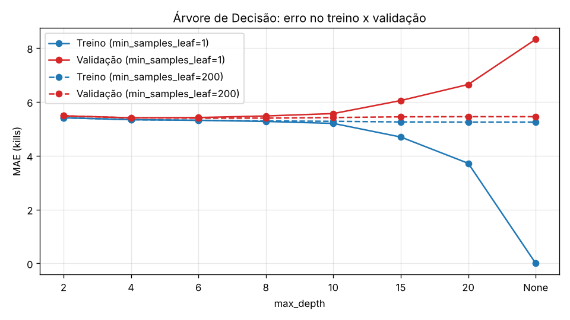

# Árvore de Decisão para regressão

> Issue #18: Implementar e avaliar Árvore de Decisão

## 1. O que foi feito

Foi implementado um `DecisionTreeRegressor` (scikit-learn) para prever `qtKill` na próxima partida do jogador, usando as 25 features de histórico do dataset final.

- **Código:** `src/models/arvore_decisao.py`
- **Testes:** `tests/test_arvore_decisao.py`
- **Dados:** dataset final (`data/processed/tb_lobby_stats_player_final.csv`, 172.773 linhas), dividido com `dividir_por_tempo`:
  - treino: 120.941 linhas;
  - validação: 25.916 linhas.
- **Conjunto de teste:** não foi usado. Ele fica reservado para a avaliação final, depois que todos os modelos forem comparados.

Para reproduzir, com o CSV original em `data/raw/`:

```bash
python -m src.data.dataset_final
python -m src.models.arvore_decisao
```

## 2. Hiperparâmetros testados

Uma árvore sem limites cresce até separar quase todas as partidas do treino, o que causa overfitting. Por isso, foram testados os dois hiperparâmetros que controlam o tamanho da árvore, em todas as combinações (40 no total):

| Hiperparâmetro | O que controla | Valores testados |
|---|---|---|
| `max_depth` | Quantos níveis de perguntas a árvore pode fazer | 2, 4, 6, 8, 10, 15, 20, sem limite (`None`) |
| `min_samples_leaf` | Quantas partidas, no mínimo, cada folha precisa ter | 1, 10, 50, 200, 1000 |

Cada combinação foi treinada no treino e avaliada no treino e na validação. A melhor foi escolhida pelo **menor MAE na validação**.

## 3. Resultados

### Melhor configuração x baseline (validação, 25.916 partidas)

| Modelo | MAE | RMSE | R² |
|---|---:|---:|---:|
| Baseline: média histórica de kills | 5,411 | 6,974 | 0,147 |
| **Árvore de Decisão** (`max_depth=6`, `min_samples_leaf=50`) | **5,393** | **6,963** | **0,150** |

A configuração `max_depth=6`, `min_samples_leaf=200` empatou no MAE (5,393), com RMSE um pouco menor (6,961).

### Efeito dos hiperparâmetros (overfitting)



| `max_depth` | `min_samples_leaf` | Folhas | MAE treino | MAE validação |
|---|---:|---:|---:|---:|
| 2 | 1 | 4 | 5,409 | 5,480 |
| 6 | 50 | 63 | 5,314 | **5,393** |
| 10 | 1 | 715 | 5,199 | 5,564 |
| 20 | 1 | 19.981 | 3,716 | 6,646 |
| sem limite | 1 | 96.605 | 0,000 | 8,324 |
| sem limite | 1000 | 93 | 5,310 | 5,396 |

A tabela completa está em `results/metrics/arvore_decisao_busca.csv`.

### Features mais importantes

| Feature | Importância |
|---|---:|
| `killsPorRound_hist` | 0,746 |
| `mediaKills_hist` | 0,129 |
| `killsPorRound_20` | 0,034 |
| `mediaKills_20` | 0,029 |
| Demais 21 features | 0,063 no total |

## 4. Análise

- **O overfitting é muito forte sem limites.** A árvore sem `max_depth` e com `min_samples_leaf=1` acerta o treino perfeitamente (MAE 0,000), mas erra 8,3 kills em média na validação, 54% a mais que o baseline. Ela decorou as partidas do treino em vez de aprender um padrão. O gráfico mostra isso: a partir da profundidade 10, o erro no treino cai e o da validação sobe.
- **Limitar o tamanho da árvore resolve o problema.** Com profundidade entre 4 e 8, ou com folhas de pelo menos 200 a 1000 partidas, o erro na validação fica estável perto de 5,39–5,41. Um `min_samples_leaf` alto funciona sozinho: mesmo sem limite de profundidade, com 1000 partidas por folha a árvore para em 11 níveis e tem MAE 5,396.
- **O ganho sobre o baseline é muito pequeno.** A melhor árvore erra 0,018 kill a menos que a média histórica (cerca de 0,3%), e o R² sobe só de 0,147 para 0,150. Na prática, a árvore aprende quase a mesma coisa que o baseline. As duas features mais usadas são kills por round e média de kills do histórico completo, que somam 87% da importância.
- **Interpretação:** com as features de histórico atuais, a quantidade de kills da próxima partida é difícil de prever além da média do jogador. Uma árvore isolada não encontrou padrões não lineares relevantes nos dados.

## 5. Próximos passos

- Usar a árvore (`max_depth=6`, `min_samples_leaf=50`) como referência para a **Random Forest** e o **Gradient Boosting**. Esses modelos combinam muitas árvores e reduzem a instabilidade de uma árvore isolada.
- Se esses modelos também ficarem perto do baseline, avaliar novas features. Exemplos: mapa da próxima partida e nível dos adversários, desde que sejam conhecidos antes da partida.
- A avaliação no conjunto de teste será feita só no final, com o modelo escolhido.
