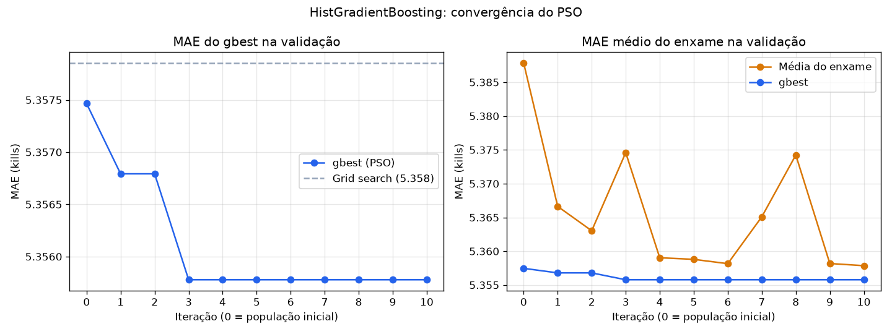

# PSO para os hiperparâmetros do HistGradientBoostingRegressor

> Issue #42: Implementar o PSO clássico para buscar os hiperparâmetros do HistGradientBoostingRegressor

## 1. O que foi feito

Foi implementado o PSO (Particle Swarm Optimization) clássico para buscar os hiperparâmetros do `HistGradientBoostingRegressor` (HGB) da issue #34, no lugar da grid search. A grid search testa 64 combinações fixas, com só 2 valores por hiperparâmetro. O PSO procura num espaço contínuo e pode testar valores entre os da grade ou fora deles.

- **Código:** `src/models/hist_gradient_boosting_pso.py` (reaproveita o `criar_modelo` de `src/models/hist_gradient_boosting.py`)
- **Testes:** `tests/test_hist_gradient_boosting_pso.py`
- **Dados:** dataset final, dividido com `dividir_por_tempo`: 120.941 partidas de treino e 25.916 de validação (as mesmas dos outros modelos).
- **Fitness:** MAE na validação, calculado por `calcular_metricas`. O PSO minimiza esse valor. Cada avaliação treina o modelo só no treino.
- **Conjunto de teste:** não foi usado em nenhuma etapa da busca. Depois da busca, a configuração encontrada foi avaliada uma única vez no teste (seção 5), como na grid search.

### Como reproduzir

Com o CSV original em `data/raw/`, execute na raiz do projeto:

```bash
python -m src.data.dataset_final
python -m src.models.hist_gradient_boosting          # grid search, usada como referência no gráfico
python -m src.models.hist_gradient_boosting_pso
python -m src.models.hist_gradient_boosting --teste  # teste da configuração da grid search
python -m src.models.hist_gradient_boosting_pso --teste
```

O `--teste` não refaz a busca: lê a configuração salva em `hist_gradient_boosting_pso_kills.csv`, treina o modelo só no treino e o avalia no teste junto com a baseline.

- Semente: `random_state=42` no modelo e `SEMENTE=42` no sorteio do PSO. Duas execuções seguidas geram arquivos idênticos.
- Tempo: cerca de 2 min 20 s (scikit-learn 1.9.1, 10 núcleos).
- Saídas:
  - `results/metrics/hist_gradient_boosting_pso_historico.csv`: uma linha por iteração, com o total de treinos, o MAE médio do enxame, o MAE do `gbest` e a configuração do `gbest`;
  - `results/metrics/hist_gradient_boosting_pso_kills.csv`: a melhor configuração, no formato de resumo dos outros modelos;
  - `results/metrics/hist_gradient_boosting_pso_teste.csv` (com `--teste`): a configuração do PSO e a baseline no teste, no mesmo formato de `hist_gradient_boosting_teste.csv`;
  - `results/figures/hist_gradient_boosting_pso_convergencia.png`: gráfico de convergência.

## 2. O algoritmo

Foi usado o PSO *global best* com peso de inércia. Cada partícula tem uma posição (uma configuração de hiperparâmetros), uma velocidade e a melhor posição que ela já encontrou (`pbest`). O enxame guarda a melhor posição de todas (`gbest`). A cada iteração:

```
v = w·v + c1·r1·(pbest − x) + c2·r2·(gbest − x)
x = x + v
```

com `r1` e `r2` sorteados entre 0 e 1 para cada partícula e cada dimensão. A equação soma três forças:

| Força | Coeficiente | Valor | O que faz |
|---|---|---:|---|
| Inércia | `w` | 0,7298 | Mantém a partícula na direção em que estava indo |
| Cognitiva | `c1` | 1,49618 | Puxa a partícula para o seu `pbest` |
| Social | `c2` | 1,49618 | Puxa a partícula para o `gbest` do enxame |

Os valores são os da literatura (Eberhart e Shi, 2000; Clerc e Kennedy, 2002). Com `w < 1` e `w > (c1 + c2)/2 − 1`, o enxame converge sem a velocidade explodir. Como `c1 = c2`, a melhor posição da partícula e a do enxame têm o mesmo peso, o que evita que todas as partículas corram cedo demais para o primeiro ponto bom.

Outras decisões:

- **População e iterações:** 10 partículas (o mínimo exigido; um valor menor gera erro) e 10 iterações.
- **Inicialização:** posições sorteadas com distribuição uniforme dentro dos limites; velocidades começam em zero.
- **Limites:** a velocidade de cada dimensão é limitada à largura do intervalo. Uma partícula que sai do intervalo volta para a borda e tem a velocidade daquela dimensão zerada, para não ficar presa empurrando contra o limite.
- **Arredondamento:** os hiperparâmetros contínuos (`learning_rate` e `l2_regularization`) são arredondados para 6 casas decimais, as mesmas gravadas nos CSVs. Assim, a configuração que o `--teste` lê do CSV é exatamente a que foi avaliada na validação.
- **Cache:** partículas diferentes que viram a mesma configuração depois do arredondamento não treinam o modelo de novo.

## 3. Espaço de busca

Cada partícula é um vetor de 6 dimensões. A `loss` e os hiperparâmetros inteiros são tratados como números contínuos no vetor e convertidos só na hora de criar o modelo:

| Dimensão | Hiperparâmetro | Limites | Conversão | Valores da grid search |
|---|---|---|---|---|
| 1 | `loss` | [0, 1] | < 0,5 → `squared_error`; ≥ 0,5 → `absolute_error` | as duas |
| 2 | `learning_rate` | [0,01; 0,3] | contínuo | 0,05; 0,1 |
| 3 | `max_iter` | [50, 500] | arredonda para inteiro | 100, 300 |
| 4 | `max_leaf_nodes` | [7, 63] | arredonda para inteiro | 15, 31 |
| 5 | `min_samples_leaf` | [10, 500] | arredonda para inteiro | 20, 200 |
| 6 | `l2_regularization` | [0, 2] | contínuo | 0, 1 |

Os limites contêm todos os valores da grade e se estendem na direção em que o MAE melhorou. Na grid search, a melhor configuração ficou na borda da grade em todos os hiperparâmetros numéricos, então o ótimo podia estar fora dela. `max_depth` continua sem limite, como na grid search.

## 4. Resultados na validação

### Convergência



| Iteração | Treinos | MAE médio do enxame | MAE do `gbest` |
|---:|---:|---:|---:|
| 0 (população inicial) | 10 | 5,3878 | 5,3575 |
| 1 | 19 | 5,3666 | 5,3568 |
| 3 | 39 | 5,3746 | **5,3558** |
| 8 | 89 | 5,3742 | **5,3558** |
| 10 | 109 | 5,3579 | **5,3558** |

- O MAE do `gbest` nunca aumentou e terminou menor que o melhor da população inicial (5,3558 contra 5,3575). Ele melhorou nas iterações 1 e 3 e depois ficou estável.
- O MAE médio do enxame caiu de 5,388 para 5,358 na última iteração, quase igual ao do `gbest`: no fim, as partículas estavam concentradas perto da melhor posição. Os picos nas iterações 3 e 8 vêm de partículas que passaram por configurações piores no caminho.
- Foram 109 treinos em vez de 110. Na iteração 1, a partícula que era o `gbest` não se moveu: a velocidade começa em zero e as três forças valem zero para ela (`pbest` e `gbest` são a própria posição). A configuração dela já estava no cache e não foi treinada de novo.
- Em todas as iterações, o `gbest` usou `absolute_error`, a mesma loss escolhida pela grid search.

### PSO x grid search (validação, 25.916 partidas)

| Busca | `loss` | `learning_rate` | `max_iter` | `max_leaf_nodes` | `min_samples_leaf` | `l2_regularization` | Treinos | MAE | RMSE | R² |
|---|---|---:|---:|---:|---:|---:|---:|---:|---:|---:|
| **PSO** | `absolute_error` | 0,047 | 201 | 9 | 293 | 1,58 | 109 | **5,3558** | **6,933** | **0,157** |
| Grid search | `absolute_error` | 0,05 | 300 | 15 | 200 | 0 | 64 | 5,3579 | 6,937 | 0,156 |

Para comparação, os outros modelos na mesma validação: Regressão Linear 5,362, KNN 5,377, Árvore de Decisão 5,393 e baseline (média histórica) 5,411.

## 5. Avaliação no conjunto de teste

As duas configurações do HGB foram escolhidas só com a validação, treinadas só no treino (120.941 partidas) e avaliadas uma única vez nas mesmas 25.916 partidas de teste. A baseline e o KNN aparecem como referência; a baseline igual nos três experimentos (MAE 5,412) confirma que as partidas de teste são as mesmas.

| Modelo | MAE validação | MAE teste | RMSE teste | R² teste |
|---|---:|---:|---:|---:|
| Baseline: média histórica de kills | 5,4109 | 5,4123 | 7,030 | 0,129 |
| KNN (K=300, manhattan) | 5,3773 | 5,3695 | **6,974** | **0,143** |
| HGB (grid search) | 5,3579 | 5,3678 | 6,992 | 0,139 |
| **HGB (PSO)** | **5,3558** | **5,3628** | 6,986 | 0,140 |

- No teste, a configuração do PSO teve o menor MAE: 0,005 kill a menos que a da grid search (0,09%) e 0,049 kill a menos que a baseline (0,9%).
- A ordem entre as duas buscas se manteve da validação para o teste, e a diferença até aumentou (de 0,0021 para 0,0050 kill).
- O KNN continua com o menor RMSE e o maior R² no teste.
- Os resultados estão em `results/metrics/hist_gradient_boosting_pso_teste.csv` e na seção "HistGradientBoosting no teste: grid search x PSO" de `notebooks/06_visualizacao_metricas.ipynb`.

## 6. Análise

- **O ganho sobre a grid search é muito pequeno.** Na validação, o PSO reduziu o MAE em 0,002 kill (0,04%), abaixo do limite de 0,005 kill definido na issue. No teste, a diferença foi de 0,005 kill, exatamente no limite. São milésimos de kill por partida: na prática, as duas configurações têm o mesmo desempenho.
- **O MAE é sensível a mudanças minúsculas nos hiperparâmetros.** Numa primeira execução, sem o arredondamento para 6 casas, o PSO seguiu outro caminho. A mesma configuração da iteração 1 (`learning_rate` 0,073221, 192 árvores, 9 folhas, `min_samples_leaf` 277, `l2_regularization` 1,380674) deu MAE 5,35562 sem o arredondamento e 5,35679 com ele: uma diferença de 0,0012 kill causada por uma mudança menor que 0,0000005 no `learning_rate` e na `l2_regularization`. Como essa variação é da mesma ordem da vantagem do PSO, parte da diferença entre as buscas pode ser só ruído. Naquela execução, o PSO terminou com MAE 5,3550 na validação, também perto de 5,355.
- **A população inicial aleatória já superou a grade.** O melhor das 10 partículas sorteadas (5,3575) já foi um pouco melhor que a melhor das 64 combinações da grade (5,3579). A região boa é larga e plana: muitas configurações diferentes chegam perto de MAE 5,356.
- **Árvores pequenas e folhas grandes continuam melhores.** O `gbest` usou 9 folhas por árvore e `min_samples_leaf` entre 277 e 293 a partir da iteração 1. É a mesma direção da grid search, mas desta vez dentro dos limites: `max_leaf_nodes` não ficou na borda do intervalo.
- **O PSO chegou a um `learning_rate` parecido com o da grade.** O `gbest` usou 0,047, perto do 0,05 da grid search, com menos árvores (201 contra 300) e árvores menores (9 folhas contra 15).
- **A `l2_regularization` mudou sem efeito claro.** O `gbest` ficou com valores entre 1,38 e 1,58, mas a grid search já tinha mostrado que esse hiperparâmetro quase não altera o MAE.
- **Custo:** o PSO fez 109 treinos (cerca de 2 min 20 s), contra 64 da grid search (cerca de 1 min 20 s).

## 7. Próximos passos

- Rodar o PSO com outras sementes para medir quanto o MAE final varia. Se a variação for maior que a diferença para a grid search, a vantagem do PSO não é confiável.
- Os resultados de teste não devem ser usados para escolher entre a configuração do PSO e a da grid search; a escolha do modelo final continua sendo feita na validação.
